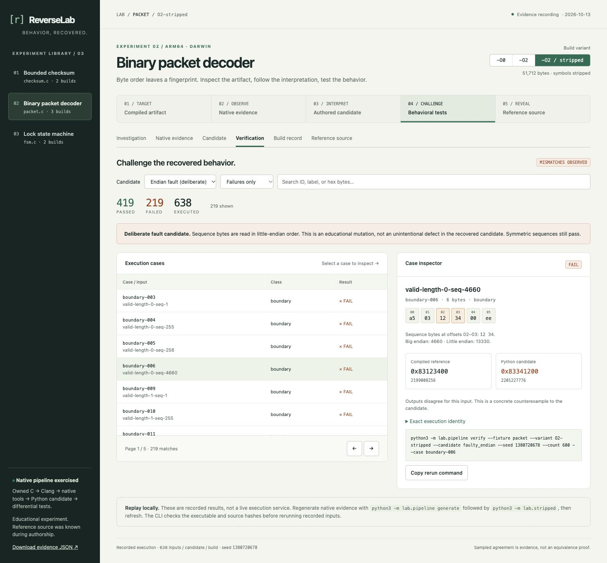

# ReverseLab

**What behavior did we recover—and what evidence supports it?**

**Specific use: catch a packet-decoder regression before trusting a replacement implementation.** Suppose a microcontroller's C decoder is the reference for a Python host tool. Sequence bytes `12 34` must mean `0x1234`; reading them as little endian silently produces `0x3412`. ReverseLab's included packet experiment catches that error, retains the exact failing packet and outputs, and supplies a guarded replay command. [Walk through that case](docs/practical-use-case.md).

[Explore the browser demo](https://aaltahms.github.io/reverse-lab/?fixture=packet&variant=O2-stripped&view=verification&candidate=faulty_endian&case=boundary-006&filter=failed&corpus=development) · [Aymen's portfolio](https://aaltahms.github.io/#reverse-lab)

ReverseLab connects tiny C programs to their compiled artifacts, native disassembly, independently expressed Python candidates, real Ghidra pseudocode for a stripped fixture, and deterministic differential tests. Its local explorer makes the investigation reviewable: follow an interpretation to the code, inspect the executable identity, and replay a concrete counterexample.

This is an educational, **source-known** experiment built with Codex assistance in October 2026. The C fixtures are self-authored. The Python candidates were authored with the reference source known. The Ghidra view contains actual decompiler output from the stripped packet binary; its function address was selected using the symbol-bearing twin. This is not a claim of blind reverse engineering. Sampled agreement is not a proof of equivalence.



## Open the explorer

Requires Python 3.9+ and a current browser. No pip/npm install, API key, or decompiler is needed to explore the included evidence recording.

```sh
cd reverse-lab
python3 -m lab.serve
```

Open **http://127.0.0.1:4173**. If you already opened a terminal in `reverse-lab`, run only the second command. The server binds to loopback and serves `web/`; it has no execution API. Ctrl+C stops it. Choose another port with `--port 4174` if needed.

1. Choose **Binary packet decoder**.
2. Select **Inspect counterexamples →**.
3. Select **boundary-006**. The input `a503123400ee` contains sequence bytes `12 34`.
4. Compare reference `0x83123400` with deliberate mutant `0x83341200`.
5. Copy the exact rerun command. Switch to **Recovered candidate** and **All cases** to inspect agreement for the same input.
6. Inspect **Native evidence**, switch `-O0`/`-O2`, then deliberately reveal **Reference source**.

Views and case selections have shareable local URLs. Arrow keys move between the view tabs; `/` focuses evidence/case search. All cases are available through pagination, filters, and search. See [walkthrough](docs/walkthrough.md).

## Rebuild and verify

Requires a native Clang compiler, `nm`, `file`, and LLVM or GNU `objdump`. On macOS use the installed Xcode Command Line Tools. The locally verified release uses **Apple Clang 17.0.0, macOS arm64, Python 3.9.6**. The UBSan corpus check passes locally; optional ASan execution timed out on this host, so no ASan success is claimed. `python3 -m lab.sanitize --address` enables ASan on a host with a working runtime. Linux support is implemented and included in CI but has not yet been executed on a hosted runner. Windows is not a supported release target.

From this directory:

```sh
python3 -m unittest discover -s tests -v
python3 -m lab.pipeline generate
python3 -m lab.holdout freeze
python3 -m lab.holdout evaluate
python3 -m lab.sanitize
python3 -m lab.webbuild
python3 -m lab.serve --production
```

Tests compile smaller corpora into `build/`; regenerate afterward to align the full demo recording with the current executables. To recreate the stripped variant, follow generation with `python3 -m lab.stripped`. To rerun its optional real analysis, use `python3 -m lab.decompile` with the toolchain described in [Ghidra investigation](docs/ghidra-investigation.md). Perform these optional steps **before freezing and evaluating**. Baseline regeneration deliberately drops prior provider and evaluation bindings; stale results are not silently attached to a new hash. Refresh the browser after generation. `CC=/path/to/clang` selects another compiler. Builds use C11, warnings as errors, debug symbols, and `-O0`/`-O2`. Nothing is installed into a global environment.

A focused replay:

```sh
python3 -m lab.pipeline verify --fixture packet --variant O2 \
  --candidate faulty_endian --seed 1380720678 --count 600 --case boundary-006
```

**Exit 1 is expected here:** it reports a detected counterexample. Exit 0 means agreement for the selected corpus; exit 2 indicates invalid input, stale/missing artifacts, or a pipeline error. Replay verifies the recorded executable, source, harness, and candidate hashes before executing.

Change the seeded corpus with `generate --seed 42 --count 1000`. For one experiment without replacing the full demo, use `generate --fixture checksum --output build/checksum-report.json`. The production exporter requires all three experiments. Commands always run from this project root; no arbitrary shell commands come from the UI.

## Release evidence

The included recording is generated from actual native execution, not hand-filled results. Each fixture has 600 seeded inputs plus directed boundaries. Every comparison retains input bytes, expected/actual uint32 values, classification, seed, case-stream digest, and candidate identity.

| Fixture | Cases per build | Recovered candidate (`-O0` and `-O2`) | Deliberate fault per build |
| --- | ---: | --- | --- |
| Bounded Fletcher-16 | 626 | 626 passed / 0 failed | — |
| Binary packet decoder | 638 | 638 passed / 0 failed | 419 passed / **219 failed** |
| Lock state machine | 636 | 636 passed / 0 failed | — |

The six baseline fixture/build pairs give **3,800 / 3,800 agreements**. The packet `-O2 / stripped` build adds **638 / 638 agreements**, bringing the included recording to **4,438 / 4,438** across seven builds. The mutant yields **657 detected mismatches** across the three packet builds. These are repeated test sets across variants, not 4,438 distinct inputs. The two optimization variants produce the same reference outputs.

The recording retains exact compiler output/flags/commands, platform, source/harness/candidate/executable SHA-256, artifact size, disassembler version, disassembly, symbol table, file identification and debug source locations. Unsupported or missing tools are represented explicitly. Project-root paths in native-tool output are normalized to `.`; those normalized fields are not byte-identical logs. Build hashes may differ with SDK, compiler, architecture, and checkout path.

## Engineering scope

- Three owned, fixed-width C functions and a robust 64-byte batch oracle; a stripped packet variant with independently rerun behavior.
- Distinct Python formulations: weighted-sum checksum, field-oriented packet parser, table-driven state machine.
- Controlled endian mutation demonstrating that some passing tests can coexist with real failures.
- Provenance and replay guards tying a report to executable and model identity.
- Candidate freezing followed by a disjoint evaluation corpus, native execution and guarded exact replay.
- Read-only, dependency-free evidence explorer with loading/error/empty states, source reveal, and keyboard navigation.
- A real REA/Ghidra CLI adapter with target/profile binding, unmodified raw Evidence exports, provider limitations and navigable pseudocode landmarks.
- A 34-test local suite and static production export; [CI workflow](.github/workflows/verify.yml) prepared for this directory as a standalone repository. No hosted CI run is claimed.

The [architecture](docs/architecture.md), [verification record](docs/verification.md), [fixture contracts](docs/contracts.md), and [backlog](docs/backlog.md) define exact boundaries.

## REA / Ghidra milestone — completed locally

**REA 6.4.0 + Ghidra 12.1.4 + Temurin JDK 21.0.12.1+1** were exercised against the owned arm64 Mach-O packet `-O2 / stripped` artifact. Ghidra observed `FUN_100000460` and returned **555 lines** of pseudocode. The explorer retains the complete response, Evidence ID, analysis-profile digest, artifact hash, procedure inventory, exact command and provider caveats.

Choose **Binary packet decoder → -O2 / stripped → Native evidence → Ghidra pseudocode**. Landmarks jump to actual input validation, checksum rejection and result packing. The latter shows sequence byte 2 shifted by 16 and byte 3 shifted by 8, supporting the authored big-endian interpretation. Follow this to Verification and the deliberate endian counterexample. The pseudocode itself has not been compiled or proved equivalent.

```sh
python3 -m lab.pipeline generate
python3 -m lab.stripped
python3 -m lab.decompile
python3 -m lab.webbuild
```

The first two commands require native tools only; the third needs the optional external toolchain. On this host it uses `build/toolchains/config.json` and tools installed in that ignored directory. On another equipped host, put the REA CLI on PATH and set `GHIDRA_INSTALL_DIR`/`JAVA_HOME`. See [exact investigation/setup details](docs/ghidra-investigation.md). The ordinary demo preview still requires Python only.

The adapter also imports a genuine compatible REA procedure/pseudocode record, rejecting target/profile/selector mismatches. Imported recordings are labeled separately from local execution; import checks do not authenticate the producer. Baseline `objdump/nm/file` evidence remains available for every fixture/build. Only the stripped packet has a Ghidra recording. MCP registration and user-wide agent configuration were not changed.

## Frozen candidate evaluation — 0.3.0

Verification now separates **Development corpus** from **Held-out evaluation**. `freeze` records candidate text and artifact/source/harness/generator hashes without selecting a seed. `evaluate` then selects a different seed, excludes development inputs and duplicates, and runs each unchanged candidate against the actual native builds. The included evaluation has 1,000 unique new byte sequences per fixture. Shareable case URLs and replay commands retain the chosen corpus; the freeze receipt is downloadable.

The October 14 recording gives **7,000 / 7,000 valid-candidate agreements** across seven builds. Each packet build detects **333** deliberate endian mismatches, for 999 repeated detections across three builds. There are **3,000 new fixture/input pairs**, reused across builds and candidates; input overlap with each fixture's development corpus is zero. The evaluation seed is **3425116644**, selected after the freeze.

```sh
python3 -m lab.holdout freeze
python3 -m lab.holdout evaluate
python3 -m lab.webbuild
```

Default seed selection uses system randomness after the freeze; `--seed N` makes an operator-specified run reproducible. This is a **source-known local procedural freeze**, not a source-blind or authenticated independent assessment. The same generator samples both corpora; unique inputs do not necessarily cover unique behavior. See [procedure and limitations](docs/held-out-evaluation.md).

The next engineering improvement is **failure minimization**. A genuine source-blind challenge needs a separate analyst context and controlled disclosure. Runtime tracing, cross-host execution and universal equivalence remain outside this release. See [uses and portfolio positioning](docs/portfolio-positioning.md) for the project's practical role alongside ResolveAI and hardware verification.

## License and credits

MIT; see [LICENSE](LICENSE). Original project implementation and fixtures by Aymen Al-Tahmschi with Codex assistance. Fletcher-16 is an established checksum algorithm; the lab orchestration, fixture contracts, comparison harness, mutant experiment, and explorer are new project work. The release archive includes genuine REA/Ghidra output for our owned target, but no REA/Ghidra implementation or third-party executable. It bundles no font, icon library, or JavaScript/Python runtime package. REA, Ghidra and Temurin retain their own licenses in the ignored optional toolchain. External compilers and system tools retain their own licenses.

Run `python3 -m lab.release` to create `dist/reverse-lab-0.3.0.zip`, containing only this project’s source, documentation, demo evidence and a SHA-256 manifest. The freeze receipt includes candidate snapshots and development inputs, but the archive excludes native binaries and optional toolchains.

A clean extraction passed all 34 tests, native regeneration, frozen evaluation, static export and exact failing-case replay. The reproducible seed gives the same 7,000 valid-candidate agreements and 999 repeated deliberate mismatches across the seven builds.

Publication contains only this project's scoped source, documentation, screenshots and redistributable recordings. The browser demo serves the included recording; native replay requires a local build. Optional tools and unrelated workspace files are excluded.
