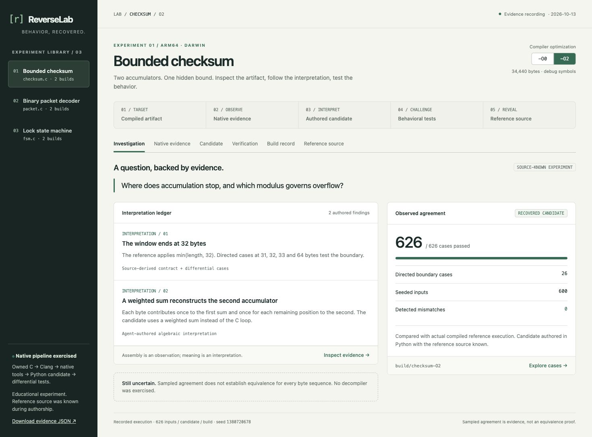
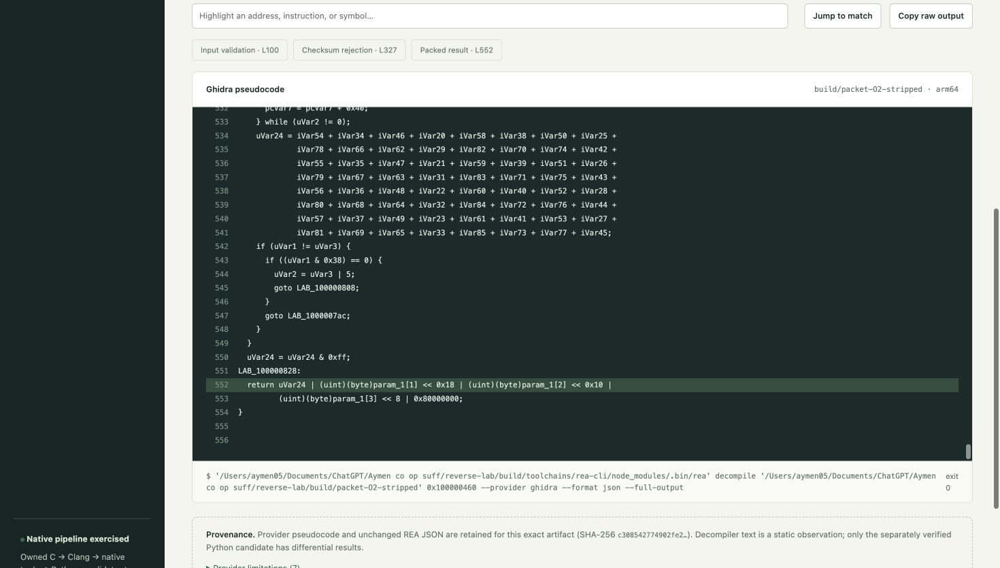
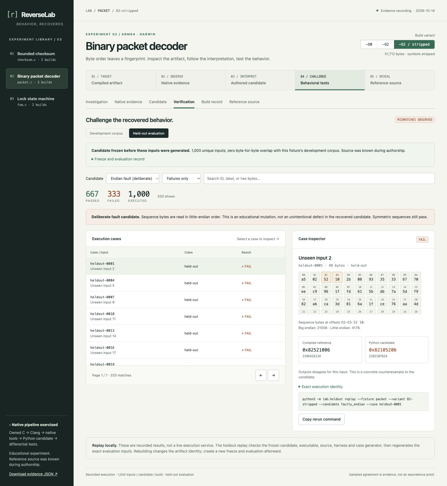

# Decoder comparison walkthrough

Start `python3 -m lab.serve` in the project root, then open http://127.0.0.1:4173.

## Start with one packet

The opening screen shows the original C decoder and a Python rewrite side by side. Read the message numbers: **4,660** versus **13,330**. Both accepted the packet, so acceptance alone did not catch the mistake. The explanation shows how swapping `12 34` to `34 12` changes the decoded number.

Choose **Compare corrected version** to see both read 4,660. Compare the buggy version again and choose **Matching sequence bytes**: both read 65,535, but this input conceals the error. The page warns about that limitation. Damaged-checksum and empty-input examples instead show readable rejection reasons.

Open **Recorded run and local replay** for the saved packed words, artifact identity and exact CLI command. The browser does not execute a native program. Open **Technical evidence** when you want the implementation and complete test data. The return button takes you back to the simple comparison.

## Technical investigation

1. **Question.** Choose the bounded-checksum program and its Overview tab. It asks about the accumulation bound and overflow modulus. Its two interpretations disclose their source-derived/algebraic basis. The uncertainty note bounds the conclusion.
2. **Observation.** Open Disassembly & Ghidra. The `-O2` arm64 demo starts by comparing length with `0x20` and selecting a bound. The rest of the listing is genuine objdump output. Search `ldrb` to highlight byte-load lines, then compare `-O0`. Assembly observation does not independently prove the claimed algorithm.
3. **Candidate.** Read the Python weighted-sum expression. It is an authored mathematical model, not original source or decompiler pseudocode. The verification corpus tests it against native execution.
4. **Counterexample.** Choose Binary packet decoder → Overview → Inspect counterexamples. Select `boundary-006`: the orange sequence bytes `12 34` become 4660 big endian versus 13330 little endian. Exact output words differ. Expand execution identity for hashes, or copy the case-specific CLI replay command.
5. **Compare.** Switch to Recovered candidate and All cases. Search `boundary-006`; outputs agree. Remove the search and page through boundary/seeded inputs. Failures only on the recovered candidate intentionally gives an empty state.
6. **Ground truth.** Select C source → Reveal reference source. Compare its implementation with the authored reconstruction. Hide it again or change fixture to reset the reveal preference.
7. **History.** Choose Lock state machine → All test cases → Boundary cases; search `fault-reset`. The packed result `0x00000402` records four transitions and final open state. It cannot be inferred from the final event alone.

The technical view uses one tab bar; the duplicate investigation-path bar was removed. View tabs support Left/Right/Home/End, and `/` focuses the current evidence/case search. Small screens stack the case inspector below the table. Replay is done through the CLI; this read-only UI never executes pasted commands.

[Narrow-screen verification screenshot](screenshots/mobile.jpg)

## Real stripped-binary investigation (0.2.0)

Choose Binary packet decoder → **-O2 / stripped** → Disassembly & Ghidra → **Ghidra pseudocode**. Ghidra recovered the anonymous function name; the original evaluate address was selected using the symbol-bearing twin. The callout identifies that source-known aid and the actual provider versions.

Use **Input validation**, **Checksum rejection** and **Packed result** to navigate the 555-line output. Search any text and use **Jump to match**. The packed result shifts input byte 2 by 16 and byte 3 by 8. Follow Verification to `boundary-006` to challenge the deliberately swapped byte order against the same compiled artifact. Its recovered Python candidate agrees on all 638 cases.

Download complete REA Evidence or expand Provider limitations to inspect retained provenance. Select another build and the Ghidra view explicitly reports that no recording exists for that artifact. Evidence subviews now persist in local URLs. No provider is invoked by clicking the UI.

## Frozen candidate evaluation (0.3.0)

In Verification, switch to **Held-out evaluation**. Each fixture has 1,000 unique byte sequences absent from its development corpus. Expand **Freeze and evaluation record** for the candidate freeze time, later seed selection, receipt hash and source-known limitation.

For the packet's stripped build, choose **Endian fault (deliberate)** and **Failures only**. The included recording detects 333 mismatches. Select `heldout-0001`: sequence `52 10` is packed as `0x82521006` by the reference and `0x82105206` by the fault candidate. Copy the holdout replay command. Switch to **Recovered candidate** to see agreement on the same input; switch to **Development corpus** to compare the earlier test set.

Reloading the URL retains the corpus, candidate and selected case. The holdout CLI rejects changed frozen files. This evaluates a source-known candidate on unused inputs; it does not establish blind recovery.

